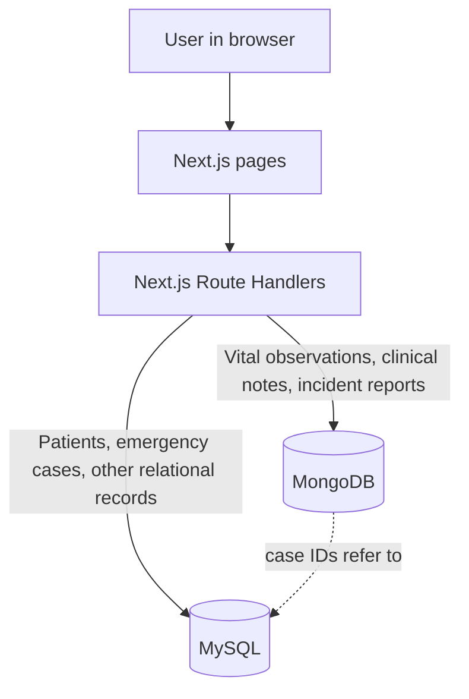
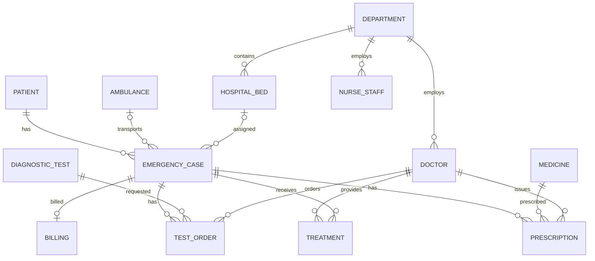

# Hospital Emergency Room Management System

A database-backed emergency-room management project built with **MySQL, MongoDB, and Next.js**. It brings patient and emergency-case records together with staff, treatment, bed, test, medicine, billing, vital-sign, clinical-note, and incident information.

The project is designed to demonstrate more than basic create/read/update/delete operations. It uses relational constraints and transactions, MongoDB document validation and aggregation, and a web application that reads and writes to both databases through server-side API routes.

> **Academic demonstration only:** Sample records are synthetic. This application does not implement login or production-ready authorization. Do not expose it publicly or enter real patient information.

## Project goals and scope

- Model emergency-room workflows using a relational database for structured data and a document database for flexible clinical records.
- Keep patient, staff, case, treatment, inventory, test, and billing data consistent with primary keys, foreign keys, checks, indexes, and transactions.
- Demonstrate useful database operations and advanced concepts, including joins, aggregation, views, procedures, triggers, document validation, and role permissions.
- Provide a Next.js interface for the dashboard, patient registry, and entry of MySQL and MongoDB records.
- Keep database credentials and connection details in environment files, not in application source code.

## System architecture



MySQL is the source of truth for patient and emergency-case identities. MongoDB records store integer case/staff/doctor references rather than copying the patient or case data. When the web app writes a MongoDB record, the API checks that its emergency case exists in MySQL.

## Database design

### MySQL relational schema

The MySQL database is named `hospital_emergency_management`. It has 13 tables:

| Table | Purpose |
|---|---|
| `PATIENT` | Patient identity, date of birth, gender, blood group, contact details, and emergency contact. |
| `DEPARTMENT` | Hospital departments and their locations; may identify a department head by doctor ID. |
| `DOCTOR` | Doctor details, specialty, shift, availability, and home department. |
| `NURSE_STAFF` | Nurses and support staff, including their role, shift, and department. |
| `AMBULANCE` | Ambulance vehicle and driver details, plus vehicle availability. |
| `HOSPITAL_BED` | Bed or ward type, current bed status, and owning department. |
| `EMERGENCY_CASE` | An ER visit: arrival time and mode, complaint, triage level, status, patient, and optional ambulance/bed. |
| `TREATMENT` | Treatment activity associated with an emergency case and the responsible doctor. |
| `MEDICINE` | Medicine catalog, manufacturer, stock quantity, and unit price. |
| `DIAGNOSTIC_TEST` | Diagnostic test catalog, type, and cost. |
| `PRESCRIPTION` | Medicine, dosage, frequency, issuing doctor, and emergency case. |
| `TEST_ORDER` | A requested diagnostic test, ordering doctor, result status, and optional result. |
| `BILLING` | Bill amount, payment details, and the emergency case being billed. Each case can have at most one bill. |

Primary and foreign keys define the relationships. Check constraints restrict values such as triage levels, case status, medicine stock, and billing amounts. Indexes support common lookups, including patient names, case arrival/status/triage, beds, medicines, treatments, prescriptions, and test orders.

Key relationships:



The complete schema, including all columns and constraints, is in [`01_schema.sql`](./01_schema.sql). The ER/design resources include [`hospital_er_diagram (1).drawio`](./hospital_er_diagram%20(1).drawio), [`relationalschema.erdplus`](./relationalschema.erdplus), and [`design.md`](./design.md).

### MongoDB document model

MongoDB stores records whose fields are naturally variable or document-shaped:

| Collection | What it stores | Why a document model fits |
|---|---|---|
| `observation_logs` | Timestamped vital-sign readings, source, recorder, and optional notes. | A sparse vital-sign object can contain the readings recorded at that time without adding many mostly-empty relational columns. |
| `clinical_notes` | Draft clinical notes, optional structured sections and tags, and amendment history. | Flexible text/sections and embedded history belong naturally together in a note document. |
| `incident_reports` | Prehospital and in-hospital safety incidents, affected cases, details, location, and timeline. | Incident types have different details; one document can contain those details and a variable-length timeline. |
| `counters` | The current sequence value used to generate incident numbers. | Supports atomic generation of unique incident identifiers. |

MongoDB uses strict `$jsonSchema` validation and indexes for case/time lookups, unique identifiers, full-text note search, and geospatial incident queries. It also demonstrates aggregation pipelines, including NEWS2-style observation analysis, incident trends, and location analysis.

**Database choice:** MySQL is used where fixed structure, joins, and referential integrity are important. MongoDB is used for flexible observations, notes, and incidents. The project does not use a vector database or semantic-embedding search; these are optional in the course requirements and are not needed for the current workflows.

More detail: [MongoDB data model](./mongodb/docs/DATA_MODEL.md), [query examples](./mongodb/docs/QUERIES.md), and [API integration notes](./mongodb/docs/API_INTEGRATION.md).

## SQL features and query examples

The SQL scripts demonstrate:

- DDL: database/table/index creation, foreign keys, checks, and schema changes.
- DML: inserts and updates in the sample-data script; select queries in the query script.
- Joins across patients, cases, departments, staff, beds, medicines, tests, and billing.
- Aggregates with `GROUP BY`, `HAVING`, `ORDER BY`, and subqueries.
- A transaction in the web patient-entry API: patient and emergency-case rows are committed together or rolled back together.
- Five views for critical cases, available beds, staff directory, test-order summary, and medicine stock.
- Three stored procedures for case details, a patient's cases, and pending bills.
- Triggers preventing negative medicine stock and negative billing totals.
- Indexes for common search and relationship columns.

## Next.js application

The web project is in [`web/`](./web/). It uses the Next.js App Router, React, TypeScript, and server-side Route Handlers. Browser pages call the API; the API connects to MySQL and MongoDB using environment configuration.

| Page / endpoint | Function |
|---|---|
| `/` | Dashboard with live/mock source selection, overview statistics, patient queue, alerts, incidents, and notes. **Export report** downloads the currently displayed dashboard data as CSV. |
| `/patients` | Patient registry loaded from MySQL, with emergency-case status, triage risk, department, summary counts, and refresh. |
| `/entries` | Creates a patient and emergency case in MySQL, then can add a vital observation, clinical note, or in-hospital incident to MongoDB. |
| `/incidents`, `/notes` | Presentational pages with example content; they are not yet connected to the MongoDB collections. |
| `GET /api/dashboard` | Reads dashboard data from MySQL and MongoDB; reports a warning when a database cannot be reached. |
| `GET /api/patients` | Reads patient registry and summary data from MySQL. |
| `POST /api/entries/sql` | Validates and transactionally inserts the patient and emergency case into MySQL. |
| `POST /api/entries/mongo` | Checks the configured demo identity and MySQL case, then calls the MongoDB repository to validate and insert the selected document. |

MongoDB repository logic lives in `mongodb/lib/repository.js` and shared query builders in `mongodb/lib/queries.js`. The API assigns the recorder/author from its configured demo identity, rather than trusting an identity sent in the form. MongoDB role permissions are represented in `mongodb/lib/access.js`.

> **Authentication limitation:** The current Next.js UI uses `MONGODB_DEMO_ROLE` and `MONGODB_DEMO_ID` as a fixed local demo identity; there is no login/session system yet. These settings are not authentication. MongoDB role definitions can be generated with `npm run roles` for a configured MongoDB server, but production-ready user authentication and authorization still need to be implemented before deployment.

## Requirements

- Windows instructions below use PowerShell.
- Node.js **20.12 or newer** (also required by the MongoDB component).
- MySQL Server **8.0.16 or newer** and MySQL Workbench or another MySQL client.
- MongoDB Server **6.0 or newer**, running locally or available through MongoDB Atlas.
- PowerShell may block the `npm` PowerShell script on some systems. Use `npm.cmd` in the commands below if `npm` is blocked by the execution policy.

## Run the project locally

### 1. Start the database servers

Start MySQL and MongoDB. For a local MongoDB server, the default URI is `mongodb://localhost:27017`.

### 2. Create and populate the MySQL schema

In MySQL Workbench, open and execute these files from the repository root in order:

1. `01_schema.sql` — creates the database, 13 tables, constraints, and indexes.
2. `02_sample_data.sql` — loads synthetic sample records.
3. `03_advanced_features.sql` — creates views, stored procedures, and triggers.
4. `04_queries.sql` — optional: run the sample read queries and aggregates.

The sample data uses fixed IDs and is intended for a fresh development database. Do not rerun it against a database that already contains those sample records unless you first reset that development database.

### 3. Configure and initialize MongoDB

From PowerShell:

```powershell
cd C:\PES\DBMS_miniproject_AM312_AM313\mongodb
npm.cmd install
Copy-Item .env.example .env
```

Edit `mongodb/.env` if needed. For a local MongoDB server, set:

```env
MONGODB_URI=mongodb://localhost:27017
MONGODB_DB=hospital_emergency_management
```

Then create collections, validators, and indexes, and load sample documents:

```powershell
npm.cmd run setup
npm.cmd run seed
```

### 4. Configure and run the Next.js app

In another PowerShell terminal:

```powershell
cd C:\PES\DBMS_miniproject_AM312_AM313\web
Copy-Item .env.example .env.local
```

Edit `web/.env.local` with the MySQL and MongoDB connection details. For example:

```env
MYSQL_HOST=localhost
MYSQL_PORT=3306
MYSQL_USER=root
MYSQL_PASSWORD=your_local_mysql_password
MYSQL_DATABASE=hospital_emergency_management

MONGODB_URI=mongodb://localhost:27017
MONGODB_DB=hospital_emergency_management

MONGODB_DEMO_ROLE=nurse
MONGODB_DEMO_ID=1
```

Set `MONGODB_DEMO_ID` to an existing `NURSE_STAFF.staff_id` when the role is `nurse`, or to an existing `DOCTOR.doctor_id` when the role is `doctor`. Sample MySQL data includes nurse staff ID `1`. Keep `.env` and `.env.local` private; never commit real passwords or database URIs.

Install dependencies and start the development server:

```powershell
npm.cmd install
npm.cmd run dev
```

Open [http://localhost:3000](http://localhost:3000). Create a patient and emergency case on **Data entry** before adding a MongoDB document, because that document must refer to an existing MySQL case ID.

## Main commands

Run commands in the indicated folder; there is no root-level npm application.

### `web/`

| Command | What it does |
|---|---|
| `npm.cmd install` | Installs Next.js app dependencies. |
| `npm.cmd run dev` | Starts the local development server at `http://localhost:3000`. |
| `npm.cmd run lint` | Runs ESLint over the web application. |
| `npm.cmd run build` | Creates a production build and runs TypeScript checks. |
| `npm.cmd run start` | Serves the production build; run `npm.cmd run build` first. |

### `mongodb/`

| Command | What it does |
|---|---|
| `npm.cmd install` | Installs MongoDB component dependencies. |
| `npm.cmd run setup` | Creates collections, validators, and indexes; safe to rerun. |
| `npm.cmd run seed` | Adds sample MongoDB documents to collections that are empty. |
| `npm.cmd run db:init` | Runs setup and resets/reloads the sample documents. **Destructive to documents in the three data collections; use only for development.** |
| `npm.cmd run queries -- --list` | Lists available MongoDB query/demo IDs. |
| `npm.cmd run queries` | Runs the read-query demonstrations. |
| `npm.cmd run queries -- --explain` | Runs query demonstrations and displays index plans. |
| `npm.cmd test` | Runs MongoDB unit, consistency, and repository tests; the live-server tests require `MONGODB_TEST_URI`. |
| `npm.cmd run roles` | Creates MongoDB roles; requires database privileges for role administration. |

For the MongoDB integration tests in PowerShell, configure the test-server URI for that terminal and run the test command:

```powershell
$env:MONGODB_TEST_URI="mongodb://localhost:27017"
npm.cmd test
```

The integration tests create and remove a randomly named throw-away test database. Use only a test MongoDB server. Transaction commit-path testing requires a replica set (MongoDB Atlas or a local replica-set configuration).

## Tests and checks

- MongoDB component tests: run `npm.cmd test` from `mongodb/`.
- Web code checks: run `npm.cmd run lint` and `npm.cmd run build` from `web/`.
- SQL examples: run `04_queries.sql` in MySQL Workbench after schema and sample-data setup.
- MongoDB component test coverage and test-file details are documented in [`mongodb/README.md`](./mongodb/README.md).

## Course requirements and project status

The project requirements call for a meaningful problem, relational design, a second database paradigm, advanced database concepts, a working Next.js interface, API/database integration, validation, security practices, testing, and setup documentation. This implementation demonstrates:

- A real emergency-room workflow rather than only generic CRUD.
- ER diagram and relational schema converted into a constrained MySQL implementation.
- SQL plus MongoDB, selected for different data shapes and documented in the MongoDB data model.
- At least four advanced concepts: MySQL transactions, views, stored procedures, triggers, and indexes; MongoDB adds validation, indexes, aggregation, and full-text search.
- A Next.js interface and Route Handlers connected to both databases using environment variables.
- Database-level validation through MySQL constraints and MongoDB `$jsonSchema` validators, plus API input checks.
- MongoDB role permissions for doctor, nurse, and admin operations.

**Known gaps before real-world use:** There is no user login/session management; the web app currently uses a fixed local MongoDB demo identity. The app is for educational demonstration and is not suitable for real patient data or public deployment. The repository's requirements draft also asks teams to include project-specific screenshots and a detailed account of individual contributions in their final submission; add those materials as required by the course.

## Security and privacy

- Use only synthetic or otherwise approved non-sensitive data.
- Keep credentials in ignored environment files and never commit them.
- Do not expose the demo server to public networks.
- Implement authenticated sessions and enforce authorization for every route before any production use.
- NEWS2 and other clinical examples are educational database demonstrations, not medical advice or a clinical decision-support system.

## Repository map

```text
01_schema.sql, 02_sample_data.sql, 03_advanced_features.sql, 04_queries.sql
  MySQL schema, sample records, advanced features, and query examples

mongodb/
  data/       MongoDB sample documents
  docs/       Data model, query reference, and API integration notes
  lib/        Query builders, repository, access rules, DB connection
  schema/     MongoDB validators and indexes
  scripts/    Setup, seed, role, query, and documentation scripts
  tests/      Unit, consistency, repository, and optional integration tests

web/
  src/app/    Next.js pages and API Route Handlers
  src/lib/    Shared server-side database adapters
```

## Contributors

- Samyuktha Vadrevu — PES1UG24AM312
- Vaishali Krishnan — PES1UG24AM313
